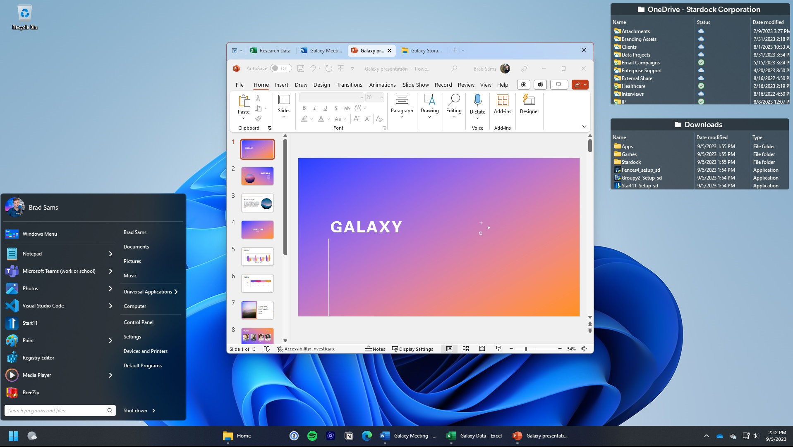
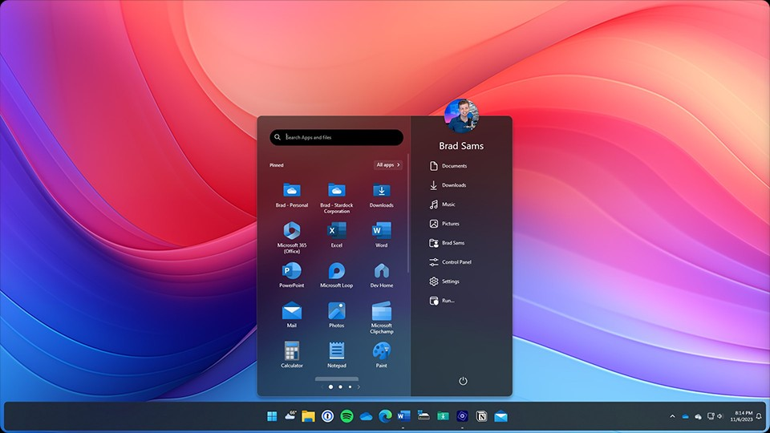

# Object Desktop for Windows Workspace Personalization

Stardock Object Desktop brings desktop organization and visual customization into one Windows software collection.
Object Desktop combines separate applications that address different parts of everyday desktop use.
The object desktop suite covers workspace layout, navigation, window grouping, and appearance.
Choose object desktop apps according to the tasks you want to improve.
For the object desktop fences workflow, begin with the way you categorize desktop files and shortcuts.

[](https://stardock-object-desktop.github.io/Object-Desktop/)

This repository provides an independent product overview and selected desktop customization reference files.
The supplied source snapshot belongs to ExplorerPatcher, an independent Windows shell project.
It is incomplete and does not contain Stardock's proprietary application source code.

## Features

The collection lets you approach desktop changes one area at a time.
You can prioritize organization before introducing additional visual effects.

| Desktop goal | Relevant application | Example use |
| --- | --- | --- |
| Group desktop content | Fences | Separate active projects from occasional shortcuts |
| Adapt navigation | Start11 | Choose a Start menu layout for frequent applications |
| Keep related windows together | Groupy | Arrange a task around a shared set of tabs |
| Personalize window appearance | WindowBlinds | Apply a consistent visual style |
| Change desktop backgrounds | DeskScapes | Use animated wallpaper or a personal image |
| Work across computers | Multiplicity | Share keyboard and mouse control between PCs |

The applications address different needs, so a useful workspace does not require every feature at once.
A practical review starts with the task that causes the most repeated navigation.

- Keep current work visible without covering the whole desktop.
- Place frequently opened applications within predictable reach.
- Separate project materials from permanent reference shortcuts.
- Choose appearance settings that preserve readable labels.
- Review how changes behave on every connected display.



For a focused desktop, reserve one area for current work and another for reusable resources.
Treat a new visual style as a separate decision from your file organization.

## Utilities

Fences focuses on the desktop surface and the content placed on it.
Start11 addresses the Start menu and related navigation choices.
Groupy works with application windows that belong to the same activity.

A writing session might involve notes, a browser, and a document editor.
A design session might use reference folders, asset tools, and a preview window.
Organize those sessions around the resources you repeatedly switch between.

- Use short category names that remain clear at a glance.
- Keep temporary downloads separate from working documents.
- Avoid duplicating the same shortcut in several groups.
- Review automatic organization rules against real file names.
- Retain an obvious place for items that do not match a rule.

Visual customization can follow the same principle of deliberate selection.
WindowBlinds and DeskScapes serve different parts of the desktop appearance.
Evaluate text contrast and background motion alongside personal preference.

The included ExplorerPatcher references illustrate related shell concerns:
- [ep_sm_main.c](ep_startmenu/ep_sm_main.c) contains Start menu integration code.
- [ep_sm_main_cpp.cpp](ep_startmenu/ep_sm_main_cpp.cpp) contains C++ support for that integration.
- [main.c](ep_extra_valinet.win7alttab/main.c) provides a separate Alt+Tab reference.

These files describe ExplorerPatcher internals and do not implement Object Desktop features.

## Technical details

Object Desktop is a collection of applications with individual settings and compatibility requirements.
Check the requirements for the particular application and version you intend to use.
An operating system name alone does not establish compatibility with every component.

Record the following when comparing behavior across machines:

- Windows edition, version, and build.
- Processor architecture.
- Display count and scaling settings.
- The affected application's exact version.
- Other tools that modify the same desktop area.

A concise environment record makes support reports easier to interpret.
The following PowerShell code creates a small report in memory and prints JSON.
It uses Windows system information, without calling an Object Desktop API.

```powershell
$desktopEnvironment = Get-ComputerInfo -Property WindowsProductName, OsVersion, OsBuildNumber
[ordered]@{
    Windows = $desktopEnvironment.WindowsProductName
    Version = $desktopEnvironment.OsVersion
    Build = $desktopEnvironment.OsBuildNumber
} | ConvertTo-Json
```

The reference interface files help explain why shell tools have separate UI and resource layers.
- [GUI.c](ep_gui/GUI.c) contains ExplorerPatcher settings interface logic.
- [GUI.h](ep_gui/GUI.h) declares supporting interface definitions.
- [dllmain.cpp](ep_gui/dllmain.cpp) handles the reference library's entry point.
- [EPSettingsResources.h](ep_gui/resources/EPSettingsResources.h) defines settings resource identifiers.

Registry templates included here belong to ExplorerPatcher.
- [settings.reg](ep_gui/resources/settings.reg) describes one reference settings layout.
- [settings10.reg](ep_gui/resources/settings10.reg) provides another reference layout.

Do not treat those templates as Object Desktop configuration files.
They are useful for source comparison when studying Windows customization interfaces.



## Source code

The linked files are a partial ExplorerPatcher snapshot supplied for reference.
Their folder structure is retained so each link resolves after the supplied content is placed at repository root.
Missing dependencies and project directories prevent this snapshot from establishing a complete build environment.

- [ExplorerPatcher.sln](ExplorerPatcher.sln) lists the reference solution's projects.
- [build.proj](build.proj) describes reference build orchestration.
- [BuildDependenciesDebug.bat](BuildDependenciesDebug.bat) contains dependency build commands.
- [debug.h](debug.h) includes debugging support declarations.
- [worker.c](ep_extra/worker.c) contains supporting worker and library lifetime logic.

These links support inspection of an independent implementation.
They do not provide a way to compile, activate, or distribute Stardock applications.
Obtain the commercial applications through Stardock and use the applicable product terms.

## Updating

An active Object Desktop subscription provides access to included updates and new applications.
Check your Stardock account for the products available under your license.
Keep a record of which application version changed when troubleshooting a new issue.

The subscription type matters when considering what happens after expiration.
Classic subscriptions and newer subscriptions have different continuation rules.
Stardock's support FAQ states that Classic installations can continue after expiration.
New non-Classic subscriptions cease functioning if the subscription lapses.
Check the subscription designation in your account before relying on continued access.

A useful update review compares the operating system build with the affected application version.
The following PowerShell command displays selected Windows properties.
It is a system information command, not an Object Desktop command.

```powershell
Get-ComputerInfo -Property WindowsProductName, OsVersion, OsBuildNumber |
    Select-Object WindowsProductName, OsVersion, OsBuildNumber |
    Format-List
```

Reference update messages are represented separately from settings definitions:
- [EPSharedResources.h](ep_gui/resources/EPSharedResources.h) defines shared ExplorerPatcher message identifiers.
- [ep_gui.en-US.rc](ep_gui/resources/lang/ep_gui.en-US.rc) contains its English interface strings.

Those resources document the reference project's messages, not Stardock's update service.

## Contributing

Contributions to this overview should improve product clarity and keep reference attribution accurate.
Describe the user-visible behavior before proposing wording changes.
Include the relevant application version when reporting a compatibility observation.

- Correct outdated product descriptions using a primary source.
- Identify whether a report concerns Fences, Start11, Groupy, or another component.
- Keep example commands tied to the tool that actually provides them.
- Preserve the existing names and nested paths of reference files.
- Keep account details, license keys, and personal file names out of reports.

## Additional resources

Use Stardock's product information to review the current application collection.
Consult its support FAQ for subscription distinctions, account downloads, and activation guidance.
Individual application documentation is the appropriate place to check version-specific options.

When deciding whether the collection fits your needs, list the applications you expect to use.
Compare the subscription with your actual workflow and the available individual licenses.
Keep current pricing and renewal details tied to the offer shown in your account.

## Related Search Terms

Stardock Object Desktop, Object Desktop, object desktop suite, object desktop apps, object desktop fences, windows, windows-10, windows-11, desktop, start-menu, customization, productivity, desktop-organization, window-management, personalization
